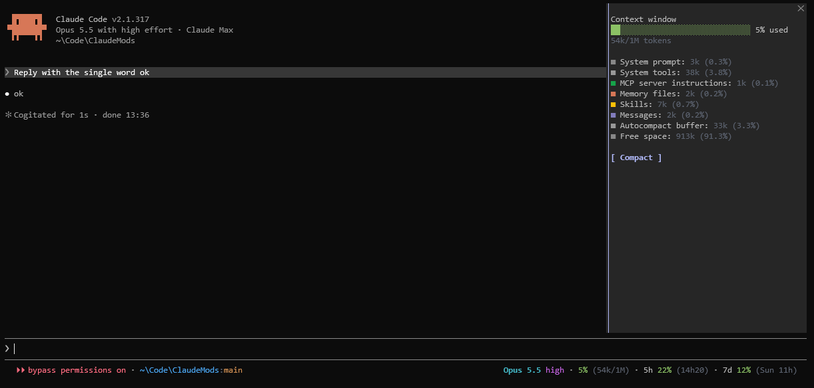

# status-bar

A Claude Code mod that enhances the status bar under the prompt: a richer, clickable and configurable view of the session, with detail panes a click away and no separate status line to set up.



## Features

The row keeps Claude Code's own permission mode indicator and fills the rest of the line.

- **Folder and branch**: on the left, with the home folder shortened to `~`; a detached head shows its short commit hash.
- **Model and effort**: the effort in use, falling back to the configured one before the first request.
- **Context**: how much of the context window is used, with the token count.
- **Usage limits**: the 5-hour and 7-day windows, with their reset times.
- **Fitting the terminal**: when the row is too long, token counts, reset times, bars and labels go first, and the folder path is shortened only as a last resort.

Every element is clickable:

- **Folder and branch**: fills `/cd ` in the prompt.
- **Model**: runs `/model`.
- **Effort**: runs `/effort`.
- **Context**: toggles a pane with the context window broken down by category, and a button that fills `/compact `.
- **Usage limits**: toggles a pane with the session's details (version, session ID, login, model, folder, cost and duration), the usage by model and each limit window, and a button that runs `/usage`.

## Installation

Install from a Claude Code session, answering `y` to add the marketplace and picking the user scope:

```text
/plugin install status-bar --marketplace thewerthon/ClaudeMods
```

## Configuration

Options are set when installing and later under `/config`. Colors take a hex value or a color name.

| Option | Default | Description |
| ------ | ------- | ----------- |
| `showLocation`, `showModel`, `showEffort`, `showContext`, `showUsage` | `true` | Show each element of the row. |
| `showContextBar`, `showUsageBars` | `false` | Draw a bar next to the context and the usage percentages. |
| `showContextLabel`, `showUsageLabel` | `false` | Lead the context and the usage figures with `Context` and `Usage`. |
| `contextWarningPercent`, `contextCriticalPercent` | `50`, `80` | Context levels at which the warning and critical colors apply. |
| `usageWarningPercent`, `usageCriticalPercent` | `50`, `80` | Usage limit levels at which the warning and critical colors apply. |
| `pathColor`, `branchColor`, `modelColor`, `effortColor`, `mutedColor` | `#4AA5F0`, `#D18F52`, `#42B3C2`, `#C162DE`, `#5C6370` | Colors of the folder, branch, model, effort and secondary details. |
| `normalColor`, `warningColor`, `criticalColor` | `#8CC265`, `#D18F52`, `#E05561` | Colors of a figure below, between and above its thresholds. |

> [!TIP]
> Claude Code paints named colors as fixed RGB values rather than the terminal's palette, so matching a terminal theme means copying its hex values into the color options.

## Limitations

The mod works within what the mod API exposes, which leaves a few gaps.

- **Terminal only**: built and tested for the terminal; the desktop app is untested.
- **Permission mode**: the mod infers the current mode to size the row around Claude Code's indicator. A session launched with `--permission-mode` differing from the configured default is sized for the default until the first prompt.
- **Usage by model**: covers the requests made since Claude Code was launched, so a resumed session leaves out what came before.
- **Panes on narrow terminals**: Claude Code does not place a pane opened from the row below about 110 columns; the mod then shows a notice instead.

## Development

The mod is TypeScript, loaded by Claude Code with no build step. From the repository root:

```text
claude --plugin-dir status-bar
claude plugin validate status-bar
claude plugin test status-bar
```

Loading the mod with `--plugin-dir` writes the API's type declarations to `.claude-plugin/types/`, which `tsconfig.json` extends; until then, editors report the missing file.
